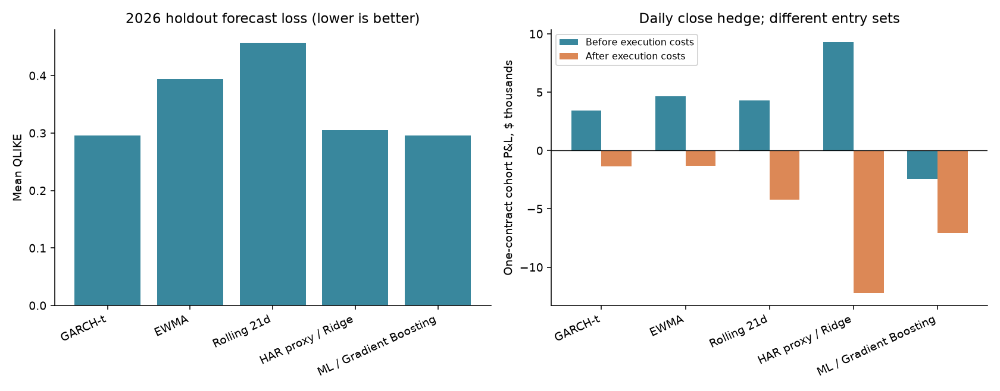

# Volatility Lab

Expiry-matched volatility forecasts and delta-hedged single-option research, with five forecasting models, explicit trading costs, and a chronological walk-forward evaluation.

[Research report](docs/RESEARCH_REPORT.md) · [中文报告](docs/RESEARCH_REPORT.zh-CN.md) · [Reproduction guide](docs/REPRODUCIBILITY.md) · [Published results](reports/oos_2026/)



## Research question

Can a forecast of future realized volatility identify individual calls or puts whose implied volatility is low enough to produce a profitable delta-hedged trade after costs?

The main study scans **20 US stocks monthly**, matches forecasts to each option's actual remaining life, and considers **7-, 30-, and 90-calendar-day target tenors**. It buys at most **one call or put per stock/month/tenor** when the forecast exceeds that contract's ask-IV by three absolute volatility percentage points. It then hedges using the underlying stock.

## Main finding

In the **January–July 2026 entry cohorts**, all five models lost money after execution costs under both daily-close and hourly hedging. GARCH and gradient boosting had nearly identical aggregate forecast QLIKE, while their selected option trades performed differently.

Daily-close hedging, one standard option contract per selected opportunity; USD totals:

| Model | Trades | Before execution costs | After execution costs | Holding RV > entry ask-IV |
| --- | ---: | ---: | ---: | ---: |
| GARCH-t | 48 | +3,404 | −1,344 | 23 / 48 |
| EWMA | 51 | +4,626 | −1,318 | 27 / 51 |
| Rolling 21-day variance | 69 | +4,300 | −4,235 | 37 / 69 |
| HAR proxy / Ridge | 209 | +9,262 | −12,209 | 102 / 209 |
| Histogram gradient boosting | 65 | −2,410 | −7,065 | 22 / 65 |

Before-execution-cost books retain financing, stock borrow, the cash benchmark, and abandoned-rights writeoffs. Totals are sums of independently funded trades, not a netted portfolio return. The report also includes common-opportunity normalized returns and residual Delta exposure.

## What is out of sample?

- **2022–2025:** previously inspected development and exploratory comparisons.
- **2026 January–July:** new historical time holdout, with exits through September 17, 2026. Rules were fixed before this study's 2026 option-chain acquisition and P&L calculation.
- Models refit monthly using prior-close information. A supervised label enters training only after its entire future-return block has finished. Earlier, completed test-period labels may enter later monthly fits.
- This is **walk-forward historical evaluation**, not a prospective live test. Daily price history was already cached, and the stock universe and strategy choices came from earlier research.

Every model sees the same **420 stock/month/tenor opportunities**. The five models select 442 entries in total, overlapping in **249 distinct contract opportunities**. Two hedge schedules and two cost books produce 996 unique replay scenarios. Seven monthly cohorts and overlapping maturities do not establish a durable model winner.

## Models and execution

| Model | Specification |
| --- | --- |
| GARCH-t | Zero-mean GARCH(1,1), Student-t innovations, up to 756 past returns |
| EWMA | Squared-return variance, decay 0.94 |
| Rolling21 | Mean of the latest 21 squared daily returns |
| HAR proxy / Ridge | Regularized pooled regression using daily variance proxies |
| Histogram gradient boosting | Pooled positive-variance forecasts with a Poisson loss |

Forecast daily variances are integrated to the actual expiry on ACT/365. American-option IV and Delta use QuantLib's Bjerksund–Stensland approximation. The replay uses observed bid/ask snapshots, whole-share hedges, one-minute-old signals, displayed-size constraints, exchange sessions, financing, borrow, and explicit fees. See the report for all assumptions.

## Run the offline checks

Python 3.12 is recommended. No API key or paid data is required for these checks.

```bash
python3.12 -m venv .venv
source .venv/bin/activate
python -m pip install -e '.[test]'
python -m unittest discover -s tests -v
python scripts/verify_release.py
python scripts/build_research_report.py
```

The archived full study passed **55 unit tests** and an independent audit of **102,570 fill records** across observed and midpoint books. The public release verifier checks the published aggregates, source hashes, fixed plans, and report links. Repeating the complete quote/fill audit requires the original local data and books; they are not distributed here.

## Repository map

```text
volatility_lab/    Forecasting, data adapters, pricing, replay, study and audit modules
tests/             Offline numerical, timing, accounting and hedge-schedule tests
docs/              English and Chinese reports, figures and reproduction notes
reports/           Aggregate outputs and original run/audit manifests
scripts/           Report generation and offline release verification
*_plan*.json       Frozen experiment specifications
requirements.lock.txt  Original research environment snapshot
```

The package also preserves earlier straddle studies, cost diagnostics and limited crypto-pilot adapters as research history. The main five-model result above is an **equity single-option study**; it does not establish crypto-strategy profitability.

## Data and reproducibility

Historical option and stock quotes came from the authenticated ThetaData adapter; daily features/actions came from Yahoo Finance, with lagged SOFR inputs. Raw market data, fitted models, credentials, and full per-minute books remain excluded from Git. Published CSVs contain aggregate research analytics.

Read the [reproduction guide](docs/REPRODUCIBILITY.md) before running archival study modules. Exact replay needs matching input files and software versions. New dates, revised vendor data, or changed rules require a separate experiment and cannot be called a new untouched test of the now-published 2026 results.
