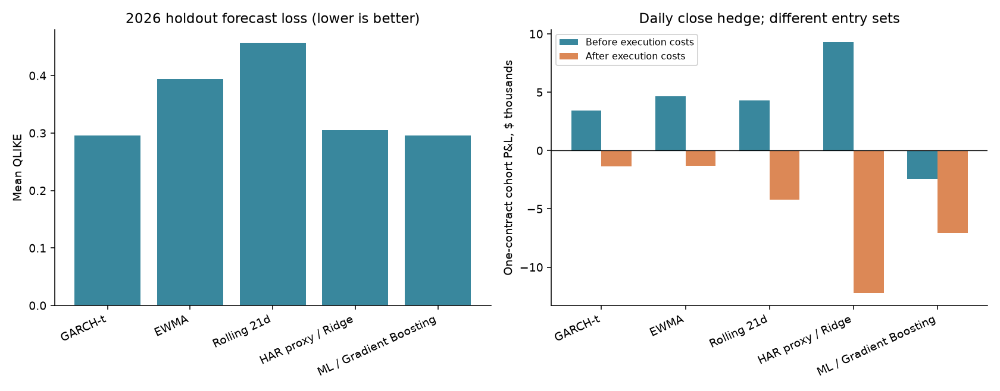

# Volatility Forecasting and Delta-Hedged Single Options

## Research finding

Five volatility models were evaluated on a common monthly opportunity grid for 20 US stocks. Forecast variance was matched to each option's remaining life. The policy bought a single call or put when forecast volatility exceeded that contract's ask-implied volatility by more than three absolute volatility percentage points, then delta-hedged with stock.

In the January–July 2026 entry cohorts, **all five models lost money after execution costs under both daily-close and hourly hedging**. GARCH and histogram gradient boosting had nearly identical aggregate QLIKE, but gradient boosting selected a worse-performing trade subset. There is no demonstrated durable trading edge or universal model winner from this sample.



## 1. Sample and research chronology

| Item | Definition |
| --- | --- |
| Development period | 2022–2025; outcomes already inspected during prior research |
| New historical time holdout | First NYSE trading session of each month, January–July 2026 |
| Entry dates | January 2 through July 1, 2026 |
| Actual exits | January 8 through September 17, 2026 |
| Target tenors | 7, 30 and 90 calendar days; actual eligible expiries used |
| Opportunity count | 20 stocks × 7 monthly origins × 3 tenors = 420 per model |
| Primary hedge schedule | Daily, at exchange close minus 15 minutes |
| Fixed comparison schedule | Every 60 elapsed minutes, with orders restricted to regular sessions |
| Entry signal | Forecast vol − decision ask-IV > 0.03 |
| Selection size | One standard option contract, multiplier 100, per selected stock/month/tenor |

The universe is AAPL, MSFT, NVDA, AMZN, JPM, KO, AMD, INTC, ADBE, CRM, QCOM, XOM, CVX, BAC, WFC, PEP, PG, UNH, MRK and DIS. It is a research convenience universe selected in earlier work; it is not a point-in-time reconstruction of an investable stock index.

The five models generated 442 selected entries altogether. Because selections overlap, these correspond to **249 distinct contract opportunities**. Two hedge schedules and two cost books give **996 unique replay scenarios**. There were no rejected entries in this run.

The January–July cutoff was specified to allow all admissible long-tenor contracts to finish within the available history; origins were not included or excluded according to realized profits.

### What “out of sample” means here

The strategy rules, parameters, threshold and two hedge schedules were fixed before this study's 2026 option-chain acquisition and P&L calculation. The 2022–2025 exploratory results were already known. Daily stock history through 2026 had already been cached, so this is a **historical chronological holdout**, not a claim that all 2026 prices had never been viewed, and not a prospective live trial.

Models refit at each monthly origin. Features use the prior actual session close. Supervised rows enter training only when the complete forward-return label block has finished by that cutoff. A 90-day-type label that is still unfolding cannot enter training merely because its anchor date is in the past. Earlier, completed test-period labels may enter later fits: this is walk-forward OOS rather than a model trained once and frozen for the entire year.

Publishing these results makes subsequent use of the same dates a reproduction or further exploration, not another untouched test.

## 2. Forecast models

| Model | Specification |
| --- | --- |
| GARCH-t | Zero-mean Student-t GARCH(1,1), fitted on at most 756 past daily returns |
| EWMA | Squared-return variance with decay 0.94 |
| Rolling21 | Mean of the latest 21 squared returns |
| HAR proxy / Ridge | Pooled regularized regression with daily variance proxies and fixed alpha 10 |
| Histogram gradient boosting | Pooled positive-variance model with Poisson loss; 150 iterations, learning rate 0.05, maximum depth 4, fixed random seed |

The two supervised models pool the 20 stocks, using a rolling 756-anchor training window. Future variance is modeled in blocks covering sessions 1, 2–5, 6–21, 22–63 and 64–84. Feature inputs include past returns, variance at multiple horizons, downside variance, high/low ranges, overnight gaps and relative volume. No option IV is supplied as a model feature. Hyperparameters are fixed rather than selected on holdout P&L.

Daily variance curves are integrated to the **actual option expiry**, using actual exchange sessions and ACT/365 annualization. Partial close-to-close intervals allocate variance in proportion to elapsed wall-clock time, including weekends. This is an approximation; intraday volatility seasonality is not estimated.

The HAR model is explicitly a **daily-proxy version**, not the original high-frequency HAR-RV specification. Labels are future squared daily close-to-close log returns; they are not a continuous realized-variance measure.

## 3. Single-option trading policy

1. On the first exchange session of each month, observe the stock and option chain at 09:45 New York time.
2. For each target tenor, choose the nearest eligible expiry. Tenor tolerances are 5, 12 and 25 calendar days for 7-, 30- and 90-day targets.
3. Find the nearest valid strike separately for the call and put; invert each ask price using the American-option approximation.
4. Choose the individual contract with the largest forecast-vol-minus-ask-IV gap, with a deterministic call tie-break. Buy only if that gap exceeds 0.03. Otherwise remain flat.
5. Enter at 10:00 New York time using valid observed quotes. Do not switch to another leg after a failed entry.
6. Hedge whole shares using one-minute-old **market-IV Delta**. Initialize the hedge independently of the later periodic schedule.
7. Plan to exit 15 minutes before the official close on the session before expiry, subject to quote eligibility and the fixed research capital-reserve rule. Unwind remaining stock at exit.

Within a given stock/month/tenor, a model's forecast is common to the call and put comparison. Maximizing forecast minus ask-IV therefore selects the lower-ask-IV valid candidate. Models primarily differ in whether that winning contract crosses their entry threshold. If several models choose the same opportunity, the exact same market-IV hedge book is reused; forecast values do not otherwise alter its hedge orders or exit rules.

This study does not enter paired straddles. Every model scans all 420 opportunities rather than inheriting an earlier fixed trade list.

## 4. Forecast accuracy

Forecast accuracy is scored independently of whether an option trade is entered. Each model has 420 scored forecasts: 20 stocks × 7 origins × 5/21/63-session horizons. These scoring horizons are separate from the option-trading tenors, whose forecasts are integrated to their actual expiries.

For realized integrated variance `v` and forecast integrated variance `v_hat`, the normalized QLIKE used here is:

```text
r = v / v_hat
QLIKE = r - log(r) - 1
```

Lower QLIKE is better. MAE and RMSE below are annualized volatility percentage-point errors. The realized target is the daily squared-return proxy described above.

| Model | Forecasts | QLIKE ↓ | MAE (vol points) ↓ | RMSE (vol points) ↓ |
| --- | --- | --- | --- | --- |
| Histogram gradient boosting | 420 | 0.295665 | 10.503 | 16.357 |
| GARCH-t | 420 | 0.295762 | 10.400 | 16.217 |
| HAR proxy / Ridge | 420 | 0.305174 | 11.174 | 16.701 |
| EWMA | 420 | 0.394077 | 10.566 | 16.677 |
| Rolling21 | 420 | 0.456569 | 11.589 | 17.766 |

Gradient boosting and GARCH are effectively tied on aggregate QLIKE; GARCH has slightly smaller aggregate MAE and RMSE. Rankings vary by horizon: gradient boosting has the lowest 5-session QLIKE, while the HAR proxy has the lowest 21- and 63-session QLIKE. Different forecast-loss rankings should not be read as trading-profit rankings.

| Forecast horizon (sessions) | Model | QLIKE ↓ | MAE (vol points) ↓ |
| --- | --- | --- | --- |
| 5 | Histogram gradient boosting | 0.4757 | 14.12 |
| 5 | GARCH-t | 0.4960 | 14.16 |
| 5 | HAR proxy / Ridge | 0.5779 | 14.52 |
| 5 | EWMA | 0.6069 | 14.47 |
| 5 | Rolling21 | 0.6703 | 15.19 |
| 21 | HAR proxy / Ridge | 0.1743 | 9.02 |
| 21 | GARCH-t | 0.2136 | 8.90 |
| 21 | Histogram gradient boosting | 0.2378 | 9.20 |
| 21 | EWMA | 0.3275 | 9.10 |
| 21 | Rolling21 | 0.3780 | 10.20 |
| 63 | HAR proxy / Ridge | 0.1633 | 9.99 |
| 63 | Histogram gradient boosting | 0.1736 | 8.19 |
| 63 | GARCH-t | 0.1777 | 8.14 |
| 63 | EWMA | 0.2478 | 8.12 |
| 63 | Rolling21 | 0.3214 | 9.38 |

## 5. Trading results

### Daily-close hedging: primary comparison

Dollar amounts are sums of one-contract, independently funded trades. Each model starts with the same 420 opportunities; counts differ because their forecasts trigger different entry decisions.

| Model | Trades | Before execution costs ($) | After execution costs ($) | Profitable before / after | RV > entry ask-IV |
| --- | --- | --- | --- | --- | --- |
| GARCH-t | 48 | +3,404 | −1,344 | 28 / 18 | 23 / 48 |
| EWMA | 51 | +4,626 | −1,318 | 28 / 20 | 27 / 51 |
| Rolling21 | 69 | +4,300 | −4,235 | 34 / 23 | 37 / 69 |
| HAR proxy / Ridge | 209 | +9,262 | −12,209 | 112 / 75 | 102 / 209 |
| Histogram gradient boosting | 65 | −2,410 | −7,065 | 26 / 20 | 22 / 65 |

“RV > entry ask-IV” compares actual entry-to-exit 15-minute-plus-overnight realized volatility with the option's **actual entry-time ask-IV**. It is a volatility-bet diagnostic, not a profit count or a direct measure of forecast error. Gamma weights, IV repricing, discrete hedges, holding-window differences and costs can make it disagree with P&L.

### Hourly hedging: fixed comparison

| Model | Trades | Before execution costs ($) | After execution costs ($) | Profitable before / after | RV > entry ask-IV |
| --- | --- | --- | --- | --- | --- |
| GARCH-t | 48 | +4,315 | −2,990 | 33 / 18 | 23 / 48 |
| EWMA | 51 | +5,508 | −4,373 | 33 / 21 | 27 / 51 |
| Rolling21 | 69 | +4,978 | −9,298 | 43 / 24 | 37 / 69 |
| HAR proxy / Ridge | 209 | +9,505 | −30,464 | 117 / 44 | 102 / 209 |
| Histogram gradient boosting | 65 | +13 | −8,579 | 34 / 19 | 22 / 65 |

All five models remain negative after execution costs. Gradient boosting's daily-hedge book is already negative before execution costs; its hourly pre-cost result is approximately flat. The four other models have positive pre-execution-cost totals but negative observed-cost totals.

### Capital normalization and residual risk

Each trade is independently funded at three times its entry 100-share underlying notional. The all-opportunity mean includes flat or failed-entry opportunities as zero and averages over all 420 opportunities. These are diagnostic cohort averages, not annualized returns or the performance of a combined capital-constrained portfolio.

| Model | Mean trade return before (%) | Mean trade return after (%) | All-opportunity mean return after (%) | Mean absolute residual Delta (shares) |
| --- | --- | --- | --- | --- |
| GARCH-t | 0.1214 | -0.0105 | -0.0012 | 9.96 |
| EWMA | 0.1467 | -0.0219 | -0.0027 | 7.03 |
| Rolling21 | 0.1008 | -0.0963 | -0.0158 | 7.67 |
| HAR proxy / Ridge | 0.0865 | -0.1117 | -0.0556 | 5.59 |
| Histogram gradient boosting | -0.0752 | -0.1801 | -0.0279 | 8.51 |

Daily hedging leaves materially more residual Delta than hourly hedging. For example, GARCH's average absolute residual model Delta is about 9.96 shares under daily-close hedging versus 2.43 under hourly hedging. Lower transaction cost therefore comes with different exposure to the realized price path.

### Exit exception

The INTC February 2, 2026 90-day-target call triggered the fixed research capital-reserve close on May 8, ahead of its planned May 14 exit. EWMA, Rolling21 and HAR selected this opportunity; GARCH and gradient boosting did not. Daily and hourly triggers differed by one minute. Each midpoint comparison follows its corresponding actual exit. This reserve is a research constraint, not a simulated broker-margin requirement. The other 248 distinct opportunities exited at their planned times.

## 6. Execution costs and cash accounting

| Component | Fixed assumption |
| --- | --- |
| Option execution | Buy at observed ask, sell at observed bid |
| Option commission | $1 per contract per executed transaction |
| Stock execution | Buy ask / sell bid, plus 1 bp extra slippage |
| Stock commission | $0.0035 per share; $0.35 minimum per order |
| Stock sell surcharge | 0.1 bp of sale proceeds |
| Cash lending | max(SOFR − 0.5%, 0) |
| Cash borrowing | SOFR + 1.5% |
| Short-stock borrow | 2% annualized |
| Signal timing | At least one-minute-old stock/Delta information |
| Trading hours | Exchange regular sessions only; no overnight hedge orders |
| Sizing | Whole shares; observed sizes, with a stock quote-size multiplier of 100 |

Rate observations use a two-calendar-day availability lag. Cash dividends are booked separately. An unbid long right can be abandoned for zero recovery under the specified eligibility rule; the engine does not invent an executable midpoint sale.

The **before-execution-cost** book keeps the observed book's order times, quantities and exits, substitutes midpoint prices for executed orders, and removes commissions, sell surcharges and slippage. It still retains funding, short-stock borrow, the idle-cash benchmark and abandoned-rights writeoffs. Removing fees changes subsequent cash interest slightly, so the before/after P&L difference need not exactly equal the immediate execution-cost sum.

Daily-close execution-cost attribution:

| Model | Option executed spread ($) | Stock spread ($) | Slippage ($) | Option fees ($) | Stock fees ($) | Total execution cost ($) |
| --- | --- | --- | --- | --- | --- | --- |
| GARCH-t | 3,768.00 | 362.60 | 228.00 | 93.00 | 287.53 | 4,739.14 |
| EWMA | 4,446.50 | 611.94 | 327.84 | 97.00 | 444.38 | 5,927.66 |
| Rolling21 | 6,502.50 | 807.14 | 410.48 | 131.00 | 660.72 | 8,511.85 |
| HAR proxy / Ridge | 15,991.00 | 1,402.17 | 1,077.15 | 372.00 | 2,560.94 | 21,403.26 |
| Histogram gradient boosting | 3,319.50 | 375.55 | 319.14 | 120.00 | 508.82 | 4,643.01 |

Option executed-spread costs exclude abandonment writeoffs. Writeoffs and financing are separate fields in the released cost CSV, avoiding double counting.

The cash bridge is:

```text
net P&L above idle-cash benchmark
  = option midpoint mark change + stock hedge mark P&L + stock dividends
    - execution spreads - slippage - commissions and sell surcharges
    - abandoned-rights writeoffs
    + cash interest - benchmark interest - stock borrow
```

## 7. Development results: context, not a second untouched test

The earlier 2022–2025 monthly GARCH-only single-option study scanned 2,880 opportunities and executed 990 trades. A fixed-entry hedge-schedule comparison produced the following totals:

| Hedge schedule | Trades | Before execution costs ($) | After execution costs ($) | Mean absolute residual Delta (shares) |
| --- | --- | --- | --- | --- |
| elapsed_60m | 990 | +34,865 | −81,878 | 2.07 |
| elapsed_120m | 990 | +35,194 | −60,430 | 2.93 |
| elapsed_720m | 990 | +57,059 | −17,619 | 6.07 |
| daily_1000 | 990 | +49,910 | −16,577 | 4.95 |
| daily_close | 990 | +59,960 | −1,884 | 7.55 |
| trading_720m | 990 | +48,889 | −9,832 | 7.92 |

The daily-close result was close to break-even before the later holdout but remained negative after costs. These outcomes had already been inspected. The 2026 primary daily-close and hourly comparison was fixed subsequently, before the new option P&L evaluation. These development results are not independent confirmation of the 2026 findings.

Calendar-hour schedules count nights and weekends but place orders only during regular sessions. A 12-calendar-hour interval therefore often results in an adjustment near the next session open. Cumulative trading-hour schedules exclude nights, weekends, holidays and early-close downtime.

## 8. Validation and limitations

The original complete local run passed 55 unit tests, including future-price perturbation checks that leave past forecasts unchanged, supervised-label completion/purging tests, expiry variance integration, hedge clocks, and accounting tests. Its independent audit checked **102,570 fill records across observed and midpoint books**, with maximum cash-transition residual below $0.000000001 and zero recorded fill-price/fee discrepancies.

The public repository preserves the numerical sources, fixed plans, aggregate tables and original audit manifests. It excludes raw market data, full per-minute books, fitted models and credentials. The public release check reconciles available aggregates and their provenance; it does not claim to repeat the full historical-quote audit without the original local inputs.

Material limits include seven monthly entry cohorts, overlapping long tenors, cross-stock dependence, a convenience stock universe, independently funded rather than netted portfolio accounts, fixed fee/borrow assumptions, unverified underlying quote-tick freshness, an American-pricing approximation with continuous dividend yield, and no actual early-exercise simulation. Missing IV can be carried forward from past observations for at most four days; missing Delta observations remain disclosed. Discrete regular-session hedging leaves overnight and intraday gap risk.

These results do not establish a profitable strategy. They show how expiry-matched forecasting, signal selection, financing and actual execution assumptions can produce different conclusions from forecast accuracy alone.

## Files

- [All model/hedge summaries](../reports/oos_2026/summary.csv)
- [Forecast scores](../reports/oos_2026/forecast_scores.csv)
- [Monthly trading breakdown](../reports/oos_2026/monthly_breakdown.csv)
- [Stock trading breakdown](../reports/oos_2026/stock_breakdown.csv)
- [Tenor trading breakdown](../reports/oos_2026/tenor_breakdown.csv)
- [Execution-cost attribution](../reports/oos_2026/cost_breakdown.csv)
- [Original complete-run audit manifest](../reports/oos_2026/verification.json)
- [Frozen OOS plan](../oos_single_leg_plan.json)
- [Reproduction guide](REPRODUCIBILITY.md)
