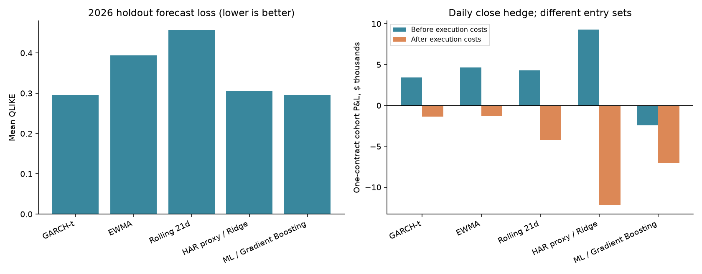

# 波动率预测与单腿期权 Delta 对冲：研究报告

## 研究结论

在 20 只美股、2026 年 1–7 月每月入场的历史时间留出测试中，**五个模型在每日和每小时对冲下，扣除执行成本后均亏损**。GARCH 与梯度提升树的整体 QLIKE 几乎相同，但两者选出的期权交易表现明显不同。因此，这个样本没有证明某个模型能稳定赚钱，也不能仅凭整体预测评分选择交易模型。

## 测试区间与样本外规则

- **2022–2025 年：** 已用于研究模型与策略规则，不能重新当作未见过的测试集。
- **2026 年 1–7 月：** 本轮新增历史时间留出。首次入场 1 月 2 日，最后入场 7 月 1 日；实际退出延伸至 9 月 17 日。
- **共同机会：** 20 股 × 7 个月 × 7/30/90 天目标期限 = 每个模型 420 个机会；未触发信号就空仓。
- **滚动训练：** 每月使用前一交易日收盘及以前的信息。监督训练标签必须已经完整走完，尚未结束的长期标签不能使用。测试期早先月份已完成的标签可以加入后续月份训练。
- 模型参数、3 个绝对波动率百分点门槛及每日收盘前／每小时两种对冲安排，均在本轮 2026 期权链获取与损益计算前固定。

这属于 **walk-forward out-of-sample**，不是年底训练一次之后全年不更新。此前已经缓存了 2026 年日线，股票池和策略选择也受早期研究影响；因此它是历史时间留出，不是前瞻实盘验证。公开结果后再使用相同日期，属于复现或继续探索。

## 策略

每月首个交易日纽约 09:45 决策，10:00 入场。每个股票／月份／目标期限，先选最近的合格到期日，再分别找最近有效行权价的 Call 与 Put，比较“匹配实际剩余期限的预测波动率 − 各自 ask-IV”。优势最大的一张超过 3 个百分点才买入，最多一张标准 100 股乘数合约。

买入后使用市场 IV 推导的 Delta、至少一分钟前的信号和整股股票对冲；只在正常交易时段成交。计划在到期前一个交易日收盘前 15 分钟退出。这里没有买入跨式，也没有沿用早期固定的 22 笔交易名单。

同一个机会中，预测值对 Call、Put 相同，胜出合约由有效候选中较低的 ask-IV 决定。各模型主要在是否触发门槛上不同。同一机会被多个模型选中时，共用相同的真实报价、对冲和现金账本。五个模型合计选择 442 次，涉及 249 个不同合约机会；两种对冲和两种成本账本共 996 个独立回放场景，没有入场失败。

## 五个模型

GARCH-t 为零均值、Student-t 创新的 GARCH(1,1)；EWMA 衰减率为 0.94；Rolling21 使用最近 21 个平方日收益。HAR proxy/Ridge 与梯度提升树在 20 股上合并训练，以过去 756 个锚点为窗口，预测未来 1、2–5、6–21、22–63、64–84 个交易日区块方差。超参数固定，不使用期权 IV 作为模型特征。

预测的是平方日收益代理方差，HAR 为代理版本，并非标准高频 HAR-RV。每日预测方差积分至实际到期日，以 ACT/365 年化；部分收盘间隔按自然时间分摊，尚未估计日内季节性。

## 预测评分

每个模型在全部股票与月份的 5/21/63 交易日预测上评分，共 420 条，不以是否入场为条件。QLIKE 使用实际方差与预测方差之比 r，计算 r − log(r) − 1，越低越好。MAE/RMSE 的单位为波动率百分点。

| Model | Forecasts | QLIKE ↓ | MAE (vol points) ↓ | RMSE (vol points) ↓ |
| --- | --- | --- | --- | --- |
| Histogram gradient boosting | 420 | 0.295665 | 10.503 | 16.357 |
| GARCH-t | 420 | 0.295762 | 10.400 | 16.217 |
| HAR proxy / Ridge | 420 | 0.305174 | 11.174 | 16.701 |
| EWMA | 420 | 0.394077 | 10.566 | 16.677 |
| Rolling21 | 420 | 0.456569 | 11.589 | 17.766 |

梯度提升树与 GARCH 的整体 QLIKE 基本打平；GARCH 的 MAE/RMSE 略低。分期限看，一周左右的 QLIKE 是梯度提升树最好，一个月和三个月是 HAR proxy 较好。评分口径与期限不同，排名也会不同。

## 交易结果：每日收盘前 15 分钟对冲

下表金额为每笔一张期权、独立资金账户的美元损益加总。

| Model | Trades | Before execution costs ($) | After execution costs ($) | Profitable before / after | RV > entry ask-IV |
| --- | --- | --- | --- | --- | --- |
| GARCH-t | 48 | +3,404 | −1,344 | 28 / 18 | 23 / 48 |
| EWMA | 51 | +4,626 | −1,318 | 28 / 20 | 27 / 51 |
| Rolling21 | 69 | +4,300 | −4,235 | 34 / 23 | 37 / 69 |
| HAR proxy / Ridge | 209 | +9,262 | −12,209 | 112 / 75 | 102 / 209 |
| Histogram gradient boosting | 65 | −2,410 | −7,065 | 26 / 20 | 22 / 65 |

“RV > entry ask-IV”是实际持有期 15 分钟加隔夜 RV 高于实际入场 ask-IV 的次数，不是盈利次数。Gamma 权重、IV 重定价、离散对冲及成本都会使两者不同。

## 每小时对冲的对照

| Model | Trades | Before execution costs ($) | After execution costs ($) | Profitable before / after | RV > entry ask-IV |
| --- | --- | --- | --- | --- | --- |
| GARCH-t | 48 | +4,315 | −2,990 | 33 / 18 | 23 / 48 |
| EWMA | 51 | +5,508 | −4,373 | 33 / 21 | 27 / 51 |
| Rolling21 | 69 | +4,978 | −9,298 | 43 / 24 | 37 / 69 |
| HAR proxy / Ridge | 209 | +9,505 | −30,464 | 117 / 44 | 102 / 209 |
| Histogram gradient boosting | 65 | +13 | −8,579 | 34 / 19 | 22 / 65 |

五个模型扣费后仍全部亏损。梯度提升树的每日对冲结果在不扣执行成本时已亏损，而每小时对冲的不扣执行成本结果接近零；其余四个模型的不扣执行成本总额为正，扣费后转负。

## 交易成本究竟是什么

| 成本 | 假设 |
| --- | --- |
| 期权价差 | 买 ask、卖 bid |
| 期权佣金 | 每张每次实际成交 $1 |
| 股票价差与滑点 | 买 ask、卖 bid，另加成交价 1bp 滑点 |
| 股票佣金 | 每股 $0.0035，每单最低 $0.35 |
| 股票卖出附加费 | 卖出金额的 0.1bp |
| 现金利息 | 贷出 max(SOFR−0.5%, 0)，借入 SOFR+1.5% |
| 股票借券 | 年化 2% |

“不扣执行成本”使用同一实际交易的时间、数量和退出时点，将可执行成交换成中间价，并去掉佣金、附加费及滑点；仍保留融资、借券、闲置现金利息基准和无人报价期权放弃的损失。移除费用也会略微改变后续现金利息，因此前后损益差额不必完全等于即时执行费用之和。

每日对冲执行成本拆分如下。期权已成交价差不含权利放弃损失，避免重复相加。

| Model | Option executed spread ($) | Stock spread ($) | Slippage ($) | Option fees ($) | Stock fees ($) | Total execution cost ($) |
| --- | --- | --- | --- | --- | --- | --- |
| GARCH-t | 3,768.00 | 362.60 | 228.00 | 93.00 | 287.53 | 4,739.14 |
| EWMA | 4,446.50 | 611.94 | 327.84 | 97.00 | 444.38 | 5,927.66 |
| Rolling21 | 6,502.50 | 807.14 | 410.48 | 131.00 | 660.72 | 8,511.85 |
| HAR proxy / Ridge | 15,991.00 | 1,402.17 | 1,077.15 | 372.00 | 2,560.94 | 21,403.26 |
| Histogram gradient boosting | 3,319.50 | 375.55 | 319.14 | 120.00 | 508.82 | 4,643.01 |

## 资金、风险与提前退出

每笔资金基数为入场 100 股标的名义金额的三倍；这不是实际经纪商保证金。全部机会平均收益把空仓计为零；它和逐笔平均收益都不是年化收益或净额投资组合收益。

| Model | Mean trade return before (%) | Mean trade return after (%) | All-opportunity mean return after (%) | Mean absolute residual Delta (shares) |
| --- | --- | --- | --- | --- |
| GARCH-t | 0.1214 | -0.0105 | -0.0012 | 9.96 |
| EWMA | 0.1467 | -0.0219 | -0.0027 | 7.03 |
| Rolling21 | 0.1008 | -0.0963 | -0.0158 | 7.67 |
| HAR proxy / Ridge | 0.0865 | -0.1117 | -0.0556 | 5.59 |
| Histogram gradient boosting | -0.0752 | -0.1801 | -0.0279 | 8.51 |

每日对冲会留下更多方向暴露，例如 GARCH 的平均绝对残余 Delta 约 9.96 股，每小时约 2.43 股。

INTC 的 2026 年 2 月 2 日、90 天目标 Call 于 5 月 8 日触发既定研究资金储备规则，早于原计划 5 月 14 日退出。EWMA、Rolling21、HAR 选中了该机会；GARCH 与梯度提升树未选中。每日与每小时触发相差一分钟，中间价对照分别固定至实际退出。其余 248 个不同机会均按计划退出。

## 审计与结论边界

完整本地研究通过 55 项测试，包含改变未来价格后历史预测不变、监督标签完成时间、方差积分、对冲时点和现金账检查。独立审计核对了实际与中间价账本中的 102,570 条成交记录；最大现金变化残差低于十亿分之一美元，成交价与费用没有记录差异。

公开仓库保留数值源代码、固定计划、汇总结果及原审计记录，不包含原始行情、完整逐分钟账本、拟合模型或 API key。公开检查验证可见汇总及其来源，不声称在缺少原始输入时重做了完整行情审计。

七个月入场批次较短，长期交易重叠、股票相关，股票池存在选择偏差。独立账户没有跨交易资金或对冲净额；借券和费用固定，报价逐笔更新新鲜度无法独立验证，期权采用美式近似定价和连续股息率，没有模拟实际提前行权。缺失 IV 最多仅向前携带四天，离散对冲仍留下隔夜和跳跃风险。

本轮没有证明策略能稳定赚钱。较好的整体波动率预测评分，并不自动产生较好的交易信号或扣费后收益。

详细开发期结果、预测期限比较与方法见 [English report](RESEARCH_REPORT.md)。原始汇总见 [results](../reports/oos_2026/)，完整复现条件见 [reproduction guide](REPRODUCIBILITY.md)。
